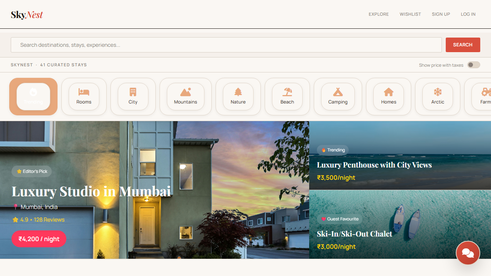
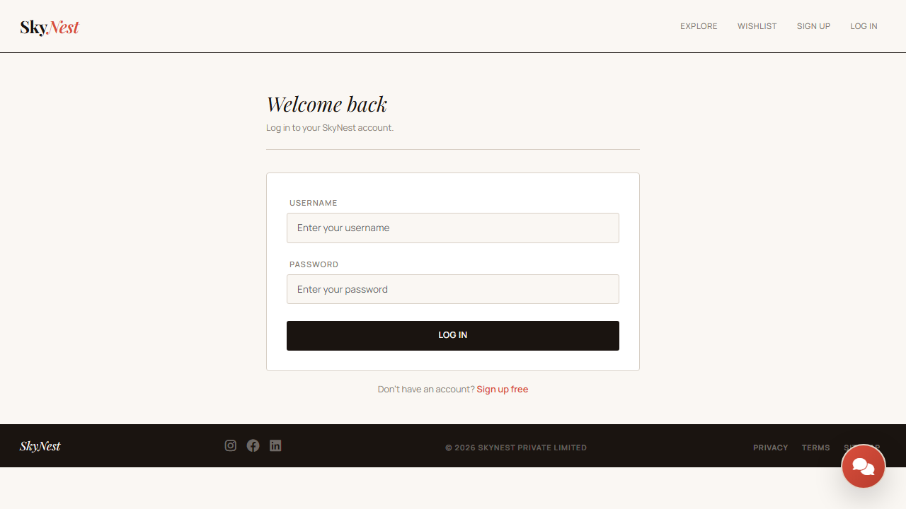

# 🏡 SkyNest

> **Book Smart. Stay Anywhere.**

[](https://nodejs.org/)
[](https://expressjs.com/)
[](https://www.mongodb.com/)
[](https://github.com/TasneemFatma012/SkyNest-platform)

SkyNest is a modern full-stack vacation rental and property booking platform that connects travelers with unique accommodations while providing hosts with powerful tools to manage properties, bookings, revenue, and guest interactions.

Designed with a clean, responsive interface and built using modern web technologies, SkyNest delivers a seamless booking experience for guests and a comprehensive management dashboard for hosts.

## 📌 Overview

- Guest-friendly property discovery and booking experience
- Host dashboard for listings, bookings, revenue, and calendar management
- Secure authentication and personalized booking flow
- Real-time notifications, wishlist, reviews, and reporting

## 🧭 How It Works

1. Guests browse and filter vacation properties by location, category, and price.
2. They book stays securely with availability checks and payment confirmation.
3. Hosts manage listings, bookings, blocked dates, and revenue from one dashboard.
4. Notifications, reviews, and export reports help improve the guest experience.

## 🎯 Project Highlights

- Full-stack property booking platform for short-term rentals
- Role-based access for guests and hosts
- Interactive dashboard with calendar and analytics
- Payment, review, wishlist, and notification modules included

## 📸 Project Preview



### Screenshots

<div align="center">
  <table>
    <tr>
      <td align="center"></td>
      <td align="center"></td>
    </tr>
    <tr>
      <td align="center"></td>
      <td align="center"></td>
    </tr>
  </table>
</div>

---

# ✨ Features

## 👤 User Authentication

* Secure Sign Up & Login
* Passport.js Authentication
* Session Management
* Role-Based Access (Guest & Host)

## 🏠 Property Management

* Create, Update & Delete Listings
* Upload Property Images
* Interactive Location Maps
* Property Search & Filtering
* Responsive Listing Cards

## 📅 Booking System

* Secure Property Booking
* Real-Time Availability Check
* Booking History
* Booking Status Tracking
* Calendar-Based Reservation Management

## 🏡 Host Dashboard

* Listing Management
* Booking Management
* Revenue Analytics
* Monthly Booking Analytics
* Interactive Calendar
* Block & Unblock Dates
* Booking Reports
* Guest Reviews Overview

## 📊 Analytics

* Monthly Revenue Chart
* Monthly Booking Statistics
* Revenue Per Property
* Total Revenue
* Total Listings
* Conversion Rate
* Booking Status Analytics

## 🔔 Real-Time Notifications

* Socket.IO Integration
* Instant Booking Alerts
* Payment Notifications
* Unread Notification Badge
* Notification History

## ❤️ Wishlist

* Save Favourite Properties
* Personalized Wishlist

## ⭐ Reviews & Ratings

* Property Reviews
* Star Ratings
* Average Rating Calculation
* Recent Reviews

## 💳 Secure Payments

* Online Payment Integration
* Payment Verification
* Booking Confirmation

## 📁 Export Reports

* CSV Export
* Excel Export (.xlsx)
* PDF Export

---

# 🛠 Tech Stack

### Frontend

* HTML5
* CSS3
* Bootstrap 5
* JavaScript (ES6)
* EJS
* Chart.js
* FullCalendar

### Backend

* Node.js
* Express.js
* MongoDB
* Mongoose

### Authentication

* Passport.js
* Express Session
* Connect-Mongo

### Real-Time Communication

* Socket.IO

### File Upload

* Multer
* Cloudinary

### Report Generation

* JSON2CSV
* ExcelJS
* PDFKit

---

# 📂 Project Structure

```text
SkyNest/
│
├── controllers/
├── middleware/
├── models/
├── public/
│   ├── css/
│   ├── js/
│   ├── images/
│   └── uploads/
├── routes/
├── utils/
├── views/
├── app.js
├── package.json
└── README.md
```

---

# 🚀 Quick Start

Clone the repository:

```bash
git clone https://github.com/TasneemFatma012/SkyNest-platform.git
```

Navigate to the project and install dependencies:

```bash
cd SkyNest
npm install
```

Create a `.env` file and configure the required values:

```env
ATLASDB_URL=your_mongodb_connection_string
SECRET=your_session_secret
MAP_TOKEN=your_mapbox_token

CLOUD_NAME=your_cloudinary_name
CLOUD_API_KEY=your_cloudinary_api_key
CLOUD_API_SECRET=your_cloudinary_api_secret
```

Run the app:

```bash
npm start
```

Or in development mode:

```bash
npm run dev
```

Open the app in your browser:

```text
http://localhost:8080
```

---

# 📸 Application Modules

* Authentication
* Property Listings
* Property Search
* Booking Management
* Host Dashboard
* Revenue Analytics
* Interactive Calendar
* Wishlist
* Reviews & Ratings
* Online Payments
* Notification System
* CSV / Excel / PDF Reports

---

# 🔮 Future Enhancements

* AI Property Recommendation
* Email Notifications
* Push Notifications
* Admin Dashboard
* Multi-language Support
* Mobile Application
* Live Chat Between Host & Guest
* Dynamic Pricing System

---

# 🤝 Contributing

Contributions are welcome!

1. Fork the repository
2. Create a new feature branch
3. Commit your changes
4. Push to your branch
5. Create a Pull Request

---

# 📄 License

This project is intended for educational and portfolio purposes.

---

# 👨‍💻 Developer

**Tasneem Fatma**

Built with ❤️ using Node.js, Express.js, MongoDB, and modern web technologies.
